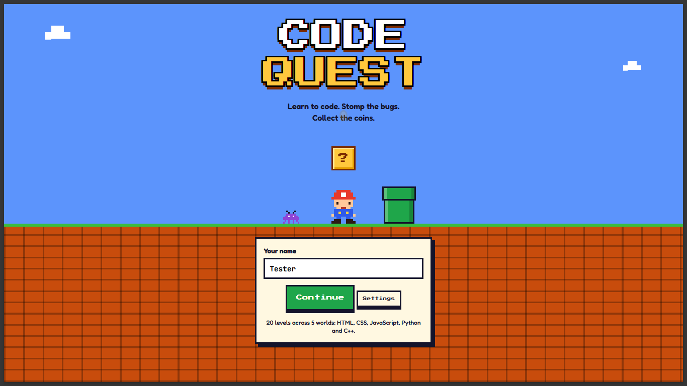
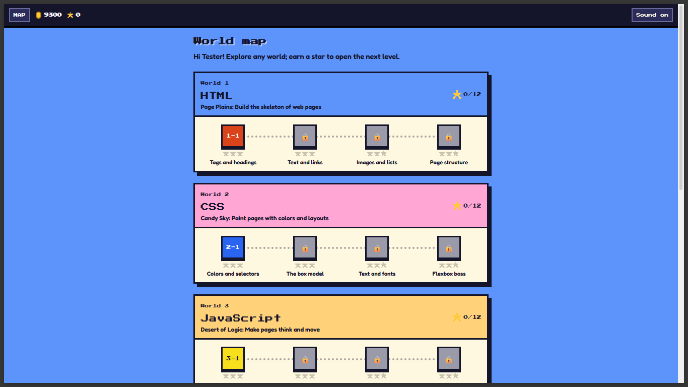
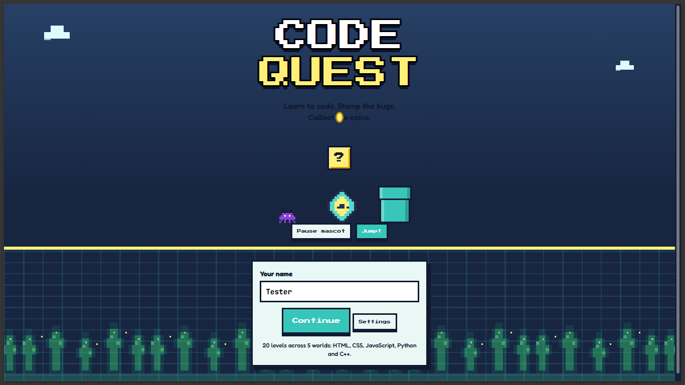

<div align="center">

# 🕹️ Code Quest

### Learn to code. Stomp the bugs. Collect the coins.

An arcade-inspired coding game where bite-sized lessons and challenges take you through **HTML, CSS, JavaScript, Python, and C++**.


</div>

---

## 📸 Screenshots

Add your screenshots to a `screenshots/` folder in the project, then use these ready-made slots. Suggested captures: the title screen, world map, a challenge, and the Voltage Grove theme.

| Home screen | World map |
|:---:|:---:|
| <!-- Add screenshots/home.png -->  | <!-- Add screenshots/world-map.png -->  |

| Coding challenge | Voltage Grove |
|:---:|:---:|
| <!-- Add screenshots/challenge.png -->  | <!-- Add screenshots/voltage-grove.png -->  |

> To use these slots, create `screenshots/` and save your images with the filenames shown above. You can change the image paths in this table to match your own filenames.

---

## ✨ Features

- **20 levels across five coding worlds**: HTML, CSS, JavaScript, Python, and C++.
- **Short lessons and varied challenges**: multiple choice, code completion, output prediction, bug finding, and ordering code.
- **Adventure and practice modes**: adventure has hearts and rewards; practice has no heart loss and does not change progress or coins.
- **Hints and progress tracking**: collect coins and stars as you learn.
- **Character shop and themes store**: use coins to unlock character styles and the **Voltage Grove** theme.
- **Interactive platformer touches**: move and jump with keyboard or on-screen controls, and stomp bugs for coins.
- **Code lab**: preview HTML and CSS; run JavaScript with a time limit and a built-in output test.
- **Settings**: guided progression, text size, sound effects, and background music controls.
- **Save backups**: progress saves in your browser, with JSON download and restore options for transferring a save.
- **Accessible, responsive UI**: keyboard navigation, visible focus, screen-reader labels, and reduced-motion support.

## 🚀 Run the game

No build step or package installation is required.

1. Download or clone this repository.
2. Open `index.html` in a modern browser.
3. Select a world and start a level.

For the best results, serve the folder through a local web server so browser storage and the JavaScript code lab work consistently. For example, if Python is installed:

```bash
python -m http.server 8000
```

Then open <http://localhost:8000>.

## 🎮 Controls

| Action | Control |
|---|---|
| Move | `←` / `→` or the on-screen arrow buttons |
| Jump | `Space` / `↑` or the on-screen Jump button |
| Answer multiple choice | Click an answer or press `1`–`4` |
| Submit typed code | `Enter` |
| Close a dialog | `Esc` (where available) |

## 💾 Saving and backups

The game automatically stores progress in the current browser. On the World Map:

1. Select **Download save backup** to save a JSON copy.
2. Transfer that file to another device if needed.
3. Select **Restore save backup** and choose the JSON file.

Restoring a backup replaces the save in that browser. Download a backup first if you want to preserve the current save.

## 🌲 Voltage Grove

Voltage Grove is a coin-unlockable alternate visual theme. Unlock it from **Themes store** on the World Map. Its pixel-art forest asset is stored at `models/forest-pixel.svg`.

## 🧰 Project files

| File | Purpose |
|---|---|
| `index.html` | Game page and interface shell |
| `style.css` | Layout, pixel-art styling, and themes |
| `javascript.js` | Game content, interaction, and save logic |
| `models/forest-pixel.svg` | Voltage Grove forest background |

## 📄 License

Add your project’s license here before publishing or accepting contributions.

---

<div align="center">

**Ready, player one? Your coding quest starts now.**

</div>
